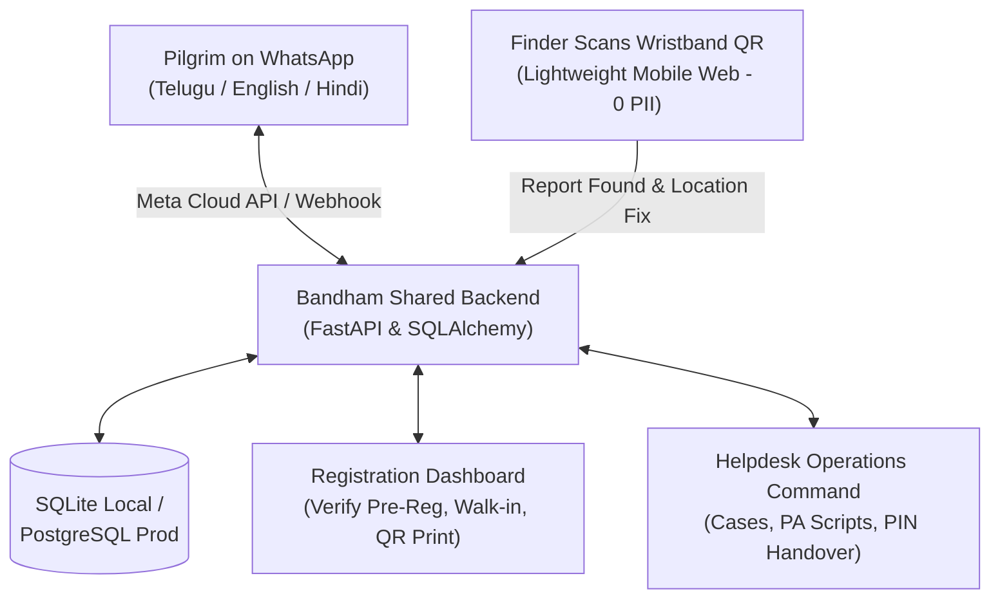

# Godavari Pushkaralu 2027 — Bandham QR Family Safety Grid & WhatsApp-First Assistant

[](https://python.org)
[](https://fastapi.tiangolo.com)
[](https://react.dev)
[](https://vitejs.dev)
[](https://tailwindcss.com)
[](https://developers.facebook.com/docs/whatsapp/cloud-api)

---

## 1. Development Environment Assessment

- **Host Environment**: Running locally on **Windows 10/11 x64** using Google Antigravity. (No cloud-hosted container or remote dev container is configured; all dependencies are isolated locally).
- **Workspace Path**: `C:\Users\saive\Downloads\gp -2027` (Confirmed: **Outside OneDrive**).
- **Python Isolation**: Isolated project-specific virtual environment in `.venv/` using Python 3.12.10.
- **Node.js Isolation**: Local project dependencies installed under `frontend/node_modules/` using Node v22.18.0 and npm 10.9.3.
- **Version Control Safety**: `.gitignore` is configured to exclude `.venv/`, `node_modules/`, `dist/`, `.env`, and `*.db`. Never commit `.env` or sensitive credentials.

---

## 2. Architecture Overview

> **Core Architectural Decision**: Bandham QR is a **WhatsApp-first public-service assistant**, not a website-first application. Pilgrims require **zero app installation**.



### The Three User-Facing Interfaces & Citizen Scan Page

1. **Pilgrim WhatsApp Assistant (`/whatsapp-sim` & Webhook)**:
   - Webhook verification & inbound message handler with HMAC SHA-256 validation (`X-Hub-Signature-256`).
   - Central state machine in **Telugu, English, and Hindi**.
   - Universal menu (`0` or "MENU") and natural-language intent matching.
   - 9 Primary Services:
     1. Family Safety / Bandham QR Guided Registration
     2. Report a Missing Child / Family Member (BOLO + Telugu PA Announcement Script)
     3. I Found a Lost Child (Compassionate safeguarding instructions)
     4. Find Ghats and Public Facilities (Kotilingala, Pushkar, Saraswati, Markandeya, Kovvur)
     5. Toilets and Sanitation Dispatch
     6. Official Services and Approved Rates (Boats, autos, cloakrooms)
     7. Report Overcharging or a Scam
     8. Emergency Helpdesk & Police Support (1800-425-2027 & 112)
     9. Change Language (తెలుగు / English / हिन्दी)

2. **Registration & QR Issuance Dashboard (`/registration`)**:
   - Review and claim pending WhatsApp pre-registrations.
   - Fast stall walk-in registration (~15 seconds target).
   - Generates cryptographically random, non-guessable Band IDs (`BND-XXXXXXXX`).
   - Generates and delivers secret 6-digit **Release PIN** to verified guardian.
   - Printable QR wristband label preview (Thermal printer ready, High error correction, **Zero PII**).
   - Band status tracking: `ISSUED`, `ACTIVE`, `LOST`, `DAMAGED`, `REVOKED`, `REPLACED`.

3. **Helpdesk & Operations Command Dashboard (`/helpdesk`)**:
   - Role-Based Access Control (RBAC): `ADMIN`, `HELPDESK_STAFF`, `REGISTRATION_OPERATOR`, `SANITATION_SUPERVISOR`.
   - Child-safety case queue with real-time guardian notification delivery tracking (`INITIATED`, `ACCEPTED_BY_PROVIDER`, `DELIVERED`, `FAILED`).
   - Last-known scan clue with timestamp and GPS accuracy fix (explicitly labeled as last-known, not real-time tracking).
   - Auto-generated **Telugu Public Address (PA) broadcast script** for ghat loudspeaker operators.
   - **Verified Handover Workflow**: Validates 6-digit Release PIN (with 5-attempt lockout) or approved Safeguarding Supervisor Fallback (for parents without phones).
   - Sanitation Dispatch Grid with team assignment, photo proof validation, and supervisor reopen capability.
   - Verified Rates Directory & Scam reports flying-squad tracking.
   - Immutable audit logging for governance and child protection.

4. **Lightweight Citizen QR Scan Page (`/scan/{band_id}`)**:
   - Instant mobile browser loading (0 MB install).
   - Reassuring safe instructions: *Never hand child to an unverified stranger*.
   - Optional browser GPS capture or manual ghat selection.
   - Direct helpline links: [SAMPLE] 1800-425-2027 & Police 112.
   - **Absolute Privacy Safeguard**: Zero names, phone numbers, or guardian details are displayed on the public scan page!

---

## 3. Quickstart & Local Execution

### Backend Setup (FastAPI)

1. Activate virtual environment:
   ```powershell
   .\.venv\Scripts\Activate.ps1
   ```
2. Run database migrations / seed and start backend server:
   ```powershell
   .\.venv\Scripts\python.exe -m uvicorn backend.app.main:app --reload --host 0.0.0.0 --port 8001
   ```
   API Documentation available at: `http://localhost:8001/docs`

### Frontend Setup (Vite + React)

1. Start frontend development server:
   ```powershell
   cd frontend
   npm run dev
   ```
   Frontend Application available at: `http://localhost:5173`

### Development Seed Accounts

Default development passwords can be customized in `.env` via `SEED_ADMIN_PASSWORD`, `SEED_HELPDESK_PASSWORD`, etc.:

| Role | Username | Environment Variable (Default) | Purpose |
|---|---|---|---|
| **Admin** | `admin` | `SEED_ADMIN_PASSWORD` (`Admin@2027`) | Full command access & audit logs |
| **Registration Operator** | `reg_operator` | `SEED_REG_PASSWORD` (`Staff@2027`) | Assisted stall registration & label printing |
| **Helpdesk & Police Staff** | `helpdesk_operator` | `SEED_HELPDESK_PASSWORD` (`Staff@2027`) | Child cases, alerts & handover verification |
| **Sanitation Supervisor** | `sanitation_lead` | `SEED_SANITATION_PASSWORD` (`Staff@2027`) | Facility tickets, photo evidence & sign-off |

---

## 4. Testing All 12 Final Acceptance Criteria

Run the automated workflow test suite:
```powershell
.\.venv\Scripts\python.exe -m pytest backend\tests\test_all_workflows.py -v
```

All 12 criteria are tested and verified:
1. `test_criterion_1_pilgrim_messages_whatsapp`: WhatsApp reply generation in Telugu/English.
2. `test_criterion_2_and_3_whatsapp_registration_to_dashboard`: WhatsApp guided registration creates pending cluster in dashboard with visual clothing recovery data.
3. `test_criterion_4_and_5_verify_and_issue_bands`: Operator claims pending cluster, generates random Band IDs, issues 6-digit PIN, and previews QR label.
4. `test_criterion_6_7_8_qr_scan_and_found_child`: Scanning QR displays safe instructions without PII, logs found report, and triggers guardian alert.
5. `test_criterion_9_case_update_and_verified_handover`: Case handover requires valid 6-digit Release PIN or supervisor fallback; bad PIN locks out after 5 attempts.
6. `test_criterion_10_unauthorized_access_restriction`: Sensitive child cases are protected by RBAC; sanitation supervisor or anonymous users receive 401/403.
7. `test_criterion_11_sanitation_and_verified_services`: Sanitation dispatch tickets, rate cards, and scam reports function end to end.
8. `test_criterion_12_simulation_vs_real_whatsapp_distinction`: Simulation mode is explicitly distinguished from real Meta Cloud API dispatch.

---

## 5. Step-by-Step Guide for Real Meta WhatsApp Cloud API Testing

When you are ready to connect and test from your **real WhatsApp account**:

### Step 1: Meta Developer Account Setup
1. Go to [developers.facebook.com](https://developers.facebook.com) and log in.
2. Click **My Apps** > **Create App**. Select **Other** > **Business**.
3. Under "Add products to your app", click **Set up** on **WhatsApp**.

### Step 2: Obtain Phone Number ID and Access Token
1. In the WhatsApp API Setup page:
   - Copy the **Phone number ID** (e.g. `104829102910...`).
   - Generate and copy a **Temporary Access Token** (or create a System User in Meta Business Suite with `whatsapp_business_messaging` permissions for a permanent token).
   - In the **To** field under "Send and receive test messages", add your real personal WhatsApp number and verify it via the 6-digit code received on your WhatsApp.

### Step 3: Configure Environment Variables
Copy `.env.example` to `.env`:
```ini
ENVIRONMENT=production
SIMULATION_MODE=False

# Meta WhatsApp Cloud API Credentials
WHATSAPP_PHONE_NUMBER_ID=your_phone_number_id_from_meta
WHATSAPP_ACCESS_TOKEN=your_access_token_from_meta
WHATSAPP_VERIFY_TOKEN=bandham_pushkaralu_verify_token_2027
WHATSAPP_APP_SECRET=your_app_secret_from_app_settings_basic
WHATSAPP_API_VERSION=v19.0

PUBLIC_BASE_URL=https://your-public-domain.com
```

### Step 4: Expose Local Webhook with Tunnel (ngrok or Cloudflare)
In a separate terminal, expose port 8000:
```bash
ngrok http 8000
# Or: cloudflared tunnel --url http://localhost:8000
```
Note the HTTPS forwarding URL (e.g. `https://abc-123.ngrok-free.app`).

### Step 5: Configure Webhook in Meta App Dashboard
1. In Meta Developer Dashboard > **WhatsApp** > **Configuration**:
2. Click **Edit** next to Webhook:
   - **Callback URL**: `https://abc-123.ngrok-free.app/api/webhook/whatsapp`
   - **Verify Token**: `bandham_pushkaralu_verify_token_2027`
3. Click **Verify and Save**. Meta will send a GET request to `/api/webhook/whatsapp` and your backend will verify the token and return the challenge.
4. Under **Webhook fields**, click **Manage** and subscribe to **`messages`**.

### Step 6: Test from Your Real WhatsApp Account
1. Open WhatsApp on your phone.
2. Send a message like `నమస్కారం` or `Hi` to the Meta test phone number.
3. You will immediately receive the official Godavari Pushkaralu Bandham Assistant welcome message.
4. Test family registration, child reporting, ghat directions, and sanitation tickets directly on WhatsApp!

---

## 6. Child Safeguarding & Privacy Governance

- **Zero PII on Wristband**: Physical wristbands and public QR scan pages display ONLY the random Band ID and helpline numbers. Child names, parent names, and phone numbers are NEVER printed or publicly rendered.
- **Handover Safeguard**: The wristband alone is NEVER proof of identity or custody. Handover requires verifying the confidential Release PIN delivered to the verified guardian, or following the approved police/supervisor safeguarding fallback.
- **Last-Known Clues**: Scan coordinates are explicitly documented as "Last-known scan clue at [time]", never misrepresented as real-time tracking.
- **Audit Governance**: All issuance, reprints, PIN resets, status changes, and handovers create immutable audit log entries.
